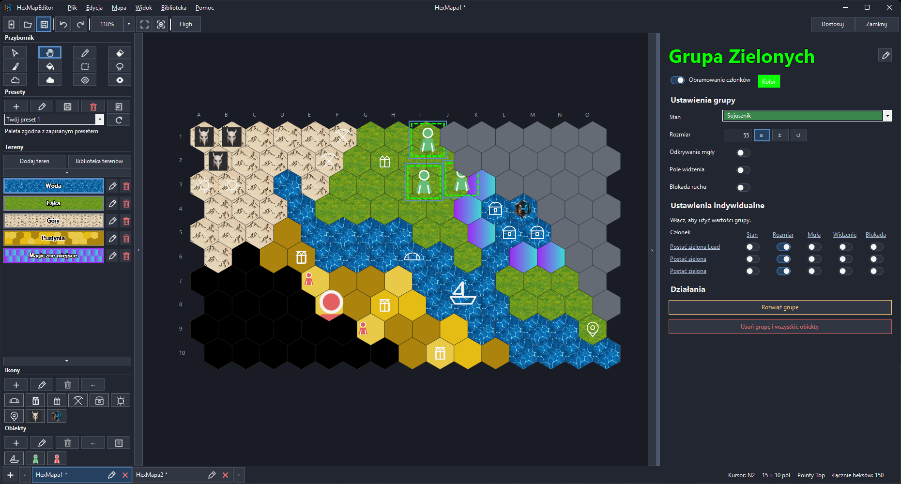
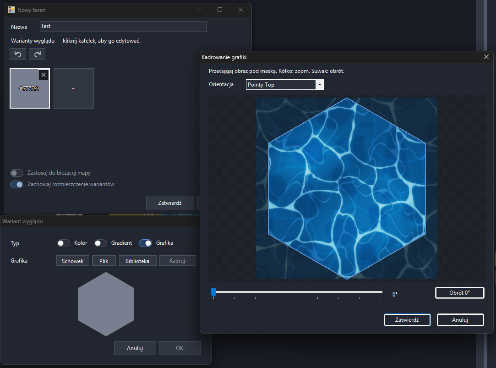

# HexMapEditor

HexMapEditor to działający offline edytor map heksagonalnych na Windows, przeznaczony m.in. do prowadzenia kampanii RPG.

**Publiczna wersja testowa 0.13.5.** Odznaki prowadzą do paczek wydania `v0.13.5`. [Raport 0.13.5](docs/raport-0.13.5.md).

## Najważniejsze funkcje

- Edycja map na siatce heksagonalnej w dwóch orientacjach. Rysowanie terenu, nanoszenie ikon i obiektów oraz obsługa mgły wojny i widoczności.
- Karty map z niezależnym widokiem i historią edycji, wspólne presety i autozapis zapisanych map.
- Opisy heksów z formatowaniem, tabelami i osadzonymi obrazami. Indywidualne i grupowe właściwości obiektów.
- Biblioteka terenów, ikon, obiektów, teł i presetów z kolejką `Library/Import`. Oryginały mają czytelne nazwy w folderach kategorii, a metadane wpisów są zapisywane w podfolderach `Metadata`.
- Mapy pozostają samodzielnymi plikami JSON `.hexmap` (Map12), z osadzonymi grafikami potrzebnymi do edycji.

## Wymagania i szybki start

Wymagany jest Windows 10 lub 11 z pełnym .NET Framework 4.8 albo 4.8.1. [Pobierz .NET Framework Runtime](https://dotnet.microsoft.com/download/dotnet-framework/net48).

1. **Instalator** — uruchom Setup i wybierz folder programu oraz Library w jednym kreatorze. Setup proponuje Program Files, gdzie Windows poprosi o zgodę administratora. Własny zapisywalny folder możesz wybrać bez podniesienia uprawnień. Późniejsze aktualizacje instalowanych kopii uruchomisz w edytorze.
2. **Portable** — rozpakuj całe ZIP do zapisywalnego folderu i uruchom `HexMapEditor.exe`. Biblioteka i dane pozostają obok kopii.
3. Wybierz **Stwórz nowy projekt**. Nowa mapa trafi do `Hexmaps` w aktywnej Library. **Zapisz jako** pozwala wybrać inny folder.

## Dokumentacja

- [Galeria](docs/galeria.md) i [specyfikacja](docs/specyfikacja.md)
- [Budowanie i pakowanie](docs/budowanie.md)
- [Raport bieżącego wydania 0.13.5](docs/raport-0.13.5.md), [plan wydań](docs/plan-wersji.md) i [opisy wcześniejszych wersji](docs/historia-wydan.md)

## Zgłaszanie błędów

Podaj wersję programu, system Windows, kroki odtworzenia oraz wynik oczekiwany i rzeczywisty. Jeśli potrzebny jest przykład, dołącz własną mapę testową bez prywatnych danych. [Zgłoszenia projektu](https://github.com/amdesar/HexMapEditor/issues).

## Licencja

Kod jest dostępny na licencji [MIT](LICENSE). Przy publikacji pochodnej wersji mile widziane jest wskazanie oryginalnego projektu.

Projekt rozwija amdesar z pomocą ChatGPT i Codexa. Ikona aplikacji powstała z pomocą ChatGPT.
